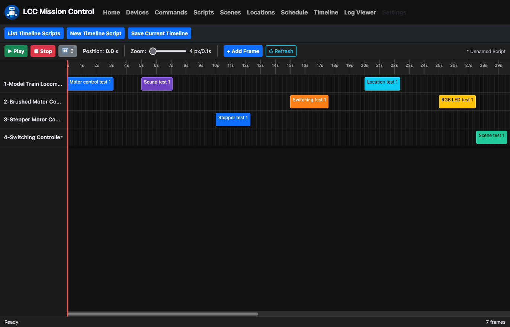
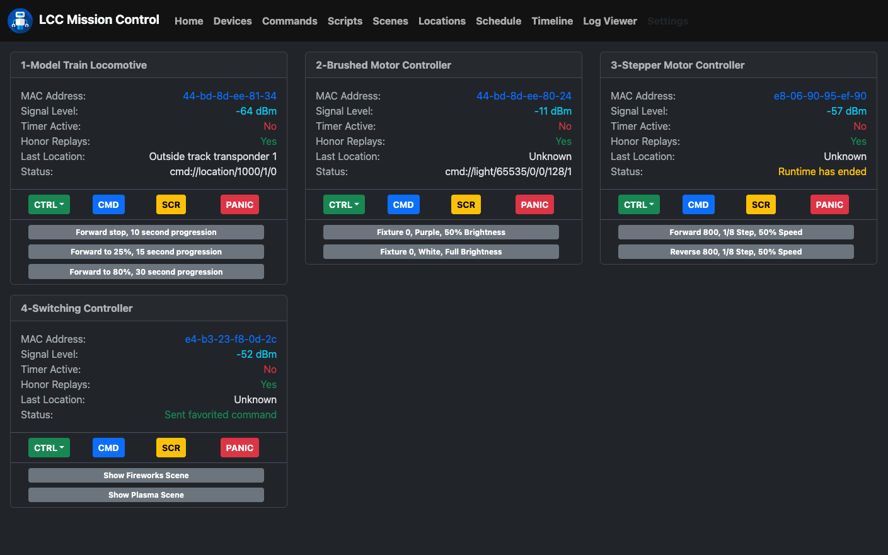

# Larry's CMD & CTRL
**aka: LCC** - Remote command and control system based on an Armbian powered SBC, ESP32, and low-frequency isolated WiFi. Can be used for any kind of automation that requires remote switching, motor direction and speed control, position tracking, LED lighting control, and scripting/scheduling. Also works great for model railroads & extreme holiday light shows!

You may contact me directly at https://panhandleponics.com 
Subscribe to the official YouTube channel at https://www.youtube.com/@PanhandlePonics

**Be sure to check out the **[Wiki](https://github.com/larry-athey/larrys-cmd-ctrl/wiki)** to learn how to use the Mission Control web app and LCC Slave PCBs.**

This project began on July 1, 2025 and does not yet have an official release but I am hoping to have the first one on January 1, 2027.

_...No, I don't use AI to design and build my projects, I actually still know how to use my brain..._

---

 

 

---

LCC is a client & server system where a Mission Control web app runs on a Pi style SBC with Armbian or any other Debian based Linux PC. The communications backbone between the server and client devices is a 100% isolated 802.11bg network in order to reject interference if the motor under control is nearby.

If your Mission Control server is hard-wired to your existing LAN, the LCC Slave network does not route into it. Don't use a weak admin user password on your server and it won't matter who is connected to its built-in access point, they aren't getting past it and reaching your internal network.

This system is intended for any **personal application** where remote control of motorized devices, remote switching, LED lighting control, position/location detection, and sound file playback is needed without the use of your existing WiFi infrastructure. This system will also work with no on-premises internet access.

Command delay time is negligible, even if an LCC Slave unit is reporting a -67 dBm signal level. This is because the system isn't dependent upon any cloud servers or other internet resources, and is why the < 100 character command exchanges usually execute on the LCC Slave as soon as you release the send button.

The recommended LCC Mission Control server is an [Orange Pi Zero 3 (1GB)](https://www.amazon.com/Orange-Pi-Allwinner-Bluetooth-Development/dp/B0H6HL19Q6/). You simply connect your phone or computer to its isolated WiFi network and open the [Mission Control](https://github.com/larry-athey/larrys-cmd-ctrl/wiki) web app. Or connect the server's ethernet port to your home router if you need local network access to it.

_**DO NOT** use simple port forwarding from your router into the Mission Control server, there is [no login system](https://github.com/larry-athey/larrys-cmd-ctrl/blob/main/Instructions/Mission-Control-lighttpd-Authentication-Setup.md)! This system is intended for **PRIVATE USE ONLY!** It is not designed for exposure to the open internet. If you feel that you need remote access, use your router's built-in VPN gateway, they all have one these days!_

### Use Cases
- RGB LED lighting automation/scripting
- Fan and actuated vent automation
- Antenna and solar panel positioning
- Conveyor and gate automation
- Irrigation system automation
- Seasonal decoration automation
- Model railroad automation

## Control Features

### Automation Timeline Editor
LCC Mission Control features an automation timeline editor that works like a multi-track DAW or video editor which allows you to create precisely timed automation sequences, and it's just downright simple to use! This can be used for creating fully choreographed holiday light shows with motorized figures that follow your background music track. Combine this with a [Sound Server](https://github.com/larry-athey/larrys-cmd-ctrl/tree/main/Sound-Server) connected to a PA system or FM transmitter and you can also add synchronized sound effects layered on top of the background music.

### Motor Control
The LCC Slave module can control standard DC brushed motors using a PWM driven H bridge driver such as an L298N, or stepper motors such as a Nema 17 with a DRV8825 driver. _(You may actually use any driver you like.)_ Brushed motor control includes direction, speed, runtime, and progression time to smooth out speed changes. If you're running a stepper motor, you have direction, the number of steps, speed, and the driver resolution from whole steps up to 1/32 steps.

### Position/Location Tracking
In the case of mobile LCC Slaves such as those on a model train or conveyor bot, position and location detection is handled by way of IR LED transponders. These are basically an IR remote control transmitter that repeats the same number over and over. The LCC Slave phones home to Mission Control when these are detected to report its location and may perform actions based on the location.

### Remote Limit Sensing
The LCC Slave module uses two GPIO pins for limit sensing so that the motor will stop running in the current direction if its limit switch is triggered. These are common in linear actuators and motorized ball valves. The unit will phone home to Mission Control to report this status.

### Remote Switching
The LCC Slave module can be any variety of ESP32, the switching capabilities are only limited by the number of exposed GPIO pins. The base code uses the Seeed Studio XAIO ESP32-S3 and has 2 outputs for switching but can be easily expanded to 16 with an MCP23017 GPIO expansion module.

### Remote MP3 Playback
Sound files (.mp3) can be stored on an SD card and played back as needed. These are useful for greetings, sound effects, warnings, etc. This requires a WWZMDiB _(DFRobot DFPlayer)_ sound module and speaker attached. Sound files can play as a single shot or in a continuous loop. An optional wireless Sound Server may also be implemented that uses custom self-powered surround sound speakers where LIDAR increases the volume of a speaker when an obstacle is in front of it. Sound can actually follow a model train around the tracks.

### Remote Neopixel/WS2812 RGB LED Control
Neopixel/WS2812 addressable LEDs can be controlled at the individual fixture/LED level or the entire network can change color at the same time. Individual fixtures support color changes have an adjustable fade time from 0 to 30 seconds. If you use long chains of LEDs (up to 65535) you may also script complex animated scenes using the built-in BASIC programming language.

### Scheduling
The LCC Mission Control server can schedule command scripts and automation timelines to run at specific times on specific days. However, in the case of single board computers such as the Raspberry Pi _(or clones)_ this requires the addition of a real time clock module to be added if the Mission Control server is isolated from the internet.

### Scripting
LCC remote control commands and scripts are completely open ended and are easy to create. Scripts can contain up to 16 sequential commands that are stored in the LCC Slave's cache and run as a single shot or may run repeatedly. Scripts can also call another script at the end of its run, which means you can actually string an endless number of commands together or create an endless loop between two scripts.

### Timer Function
Each configured device has a timer that can run any command pair (on and off commands). This is an on-the-fly counterpart to the Scheduling system. These are handy for setting things like lights, sprinklers, fans, etc to run for any amount of time up to 1 day (86400 seconds) and then automatically turn off.
